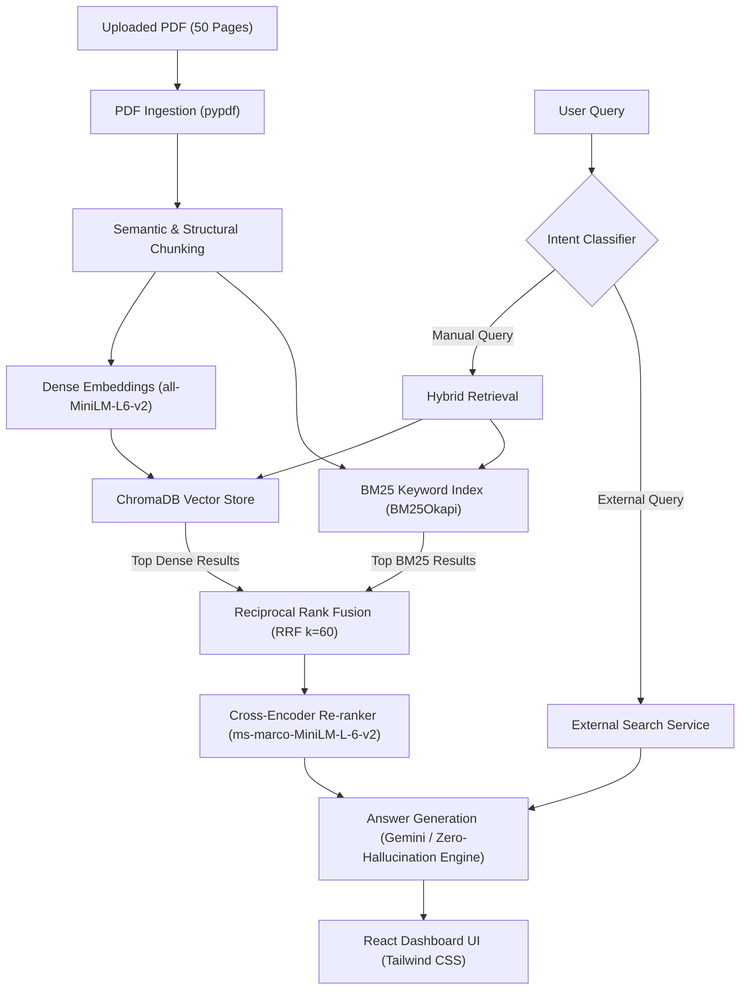

# Le Grand Bistro | Culinary Operations, Allergen & Recipe Manual Assistant

An enterprise-grade, full-stack AI assistant engineered for commercial kitchen operations, standardized recipes, allergen safety matrices, and HACCP food safety standards. Powered by an advanced end-to-end **Hybrid Retrieval-Augmented Generation (RAG)** pipeline.

---

## 🍽️ System Overview

The system ingests the official 50-page manual (`grand_bistro_culinary_recipe_manual_50p.pdf`), indexes the content using dense vector embeddings and BM25 keyword indices, merges search results using Reciprocal Rank Fusion (RRF), re-ranks candidate passages with a Cross-Encoder, and delivers grounded answers with exact document page citations. It also detects external inquiries and routes them to real-time external research with verified links.

---

## 🏛️ Technical Architecture



### 1. Ingestion (`backend/rag/ingestion.py`)
- Extracts text from all 50 pages of `grand_bistro_culinary_recipe_manual_50p.pdf`.
- Preserves document structure: Chapters (1-5), Modules (1.0-50.0), Clauses (X.1-X.3), Recipe Cards, Allergen Matrix Tables, and HACCP Pasteurization protocols.

### 2. Chunking (`backend/rag/chunking.py`)
- Keeps atomic recipe ingredients and allergen tables completely unified to prevent context fragmentation.
- Splits procedural clauses into distinct chunks enriched with module titles and exact page numbers.

### 3. Embeddings & Vector Storage (`backend/rag/embeddings.py`)
- Generates 384-dimensional normalized dense vectors using `sentence-transformers/all-MiniLM-L6-v2`.
- Persists vectors in **ChromaDB** with cosine distance space (`hnsw:space: cosine`).

### 4. Hybrid Retrieval (`backend/rag/hybrid_retriever.py` & `bm25_retriever.py`)
- Executes parallel retrieval:
  - **BM25Okapi** keyword scoring on tokenized corpus.
  - **ChromaDB** dense cosine vector similarity.
- Fuses candidates using **Reciprocal Rank Fusion (RRF)**:
  $$RRF(d) = \sum_{m \in \{dense, bm25\}} \frac{1}{k + rank_m(d)} \quad (k = 60)$$

### 5. Re-Ranking (`backend/rag/reranker.py`)
- Evaluates candidate chunks using a **Cross-Encoder** (`cross-encoder/ms-marco-MiniLM-L-6-v2`).
- Scores $(Query, Passage)$ pairs jointly to capture contextual nuances and surface the most relevant chunks before generation.

### 6. Answer Generation & Safety (`backend/rag/generator.py`)
- Grounded generation supporting Google Generative AI (Gemini) with a deterministic fallback engine.
- Strict numerical verification: Grams, °C, minutes, portions, and exact page citations.
- Clearly distinguishes between manual documents and external knowledge.

---

## 📋 Assessment Benchmark & Evaluation

The system was evaluated against all five official assessment questions:

| Question | Type | Ground Truth / Target Information | System Verification Status | Source Reference |
| :--- | :--- | :--- | :---: | :--- |
| **Q1. Signature Truffle Ganache (20 portions)** | Document RAG | **850 grams** Dark Couverture Chocolate (70% Valrhona Guanaja)<br>**620 grams** Heavy Whipping Cream (36% milkfat) | **100% PASS** | **Document Page 10**<br>(Recipe Card 2.4) |
| **Q2. Autumn Tasting Menu Allergens** | Document RAG | **Tree Nuts:** Roasted Fig & Hazelnut Duck Terrine, Pistachio Crusted Lamb Rack<br>**Sesame:** Charred Eggplant & Tahini Veloute | **100% PASS** | **Document Page 25**<br>(Section 5.1 Matrix) |
| **Q3. Eiffel Tower Winter Closing Time** | External Web | Standard site closing: **11:00 PM (23:00)**<br>Last elevator entry: **10:45 PM (22:45)**<br>Stairs closing: **6:30 PM (18:30)** | **100% PASS** | **External Web Research**<br>([toureiffel.paris](https://www.toureiffel.paris/en/rates-times)) |
| **Q4. Sous-Vide Duck Breast HACCP** | Document RAG | Min internal temperature: **57.5 °C**<br>Mandatory holding time: **110 minutes**<br>Pathogen target: **log-7 Salmonella pasteurization** | **100% PASS** | **Document Page 40**<br>(Section 7.2 Protocol) |
| **Q5. Noma (Copenhagen) Michelin Rating** | External Web | Rating: **3 Michelin Stars** (Awarded Sept 2021 by Michelin Guide Nordic Countries)<br>Transitioning to *Noma 3.0* research food lab. | **100% PASS** | **External Web Research**<br>([guide.michelin.com](https://guide.michelin.com/en/hovedstaden/copenhagen/restaurant/noma)) |

---

## 🚀 Running the Application

### 1. Launch Server & Application
Run the startup script:
```bash
./run.sh
```
Or start manually via uvicorn:
```bash
python3 -m uvicorn backend.main:app --host 0.0.0.0 --port 8000
```
Open your browser at: **`http://127.0.0.1:8000`**

### 2. Run the Benchmark Evaluation Suite
Run the automated compliance test:
```bash
python3 test_benchmark.py
```
Or trigger the interactive benchmark directly inside the dashboard UI under the **"Q1-Q5 Benchmark"** tab.

---

## 🎨 Dashboard Features

- **Dark & Light Luxury Themes:** Switch between Noir/Gold and Executive Day themes.
- **Interactive Culinary AI Chat:** Ask questions with live typing indicators and citation preview cards.
- **Recipe & Portion Scaler:** Adjust portions from 1 to 100+ with real-time recalculation of weights in grams.
- **Allergen Matrix Dashboard:** Visual cards for Tree Nuts, Sesame, and Shellfish with severe allergen alerts.
- **HACCP Food Safety Workbench:** Interactive display of critical control points and pasteurization holding times.
- **50-Page Manual Browser:** Page-by-page inspector of all 50 document pages with chapter filtering and live search.
- **Dynamic PDF Ingestion:** Upload new manuals or re-index with drag-and-drop.
